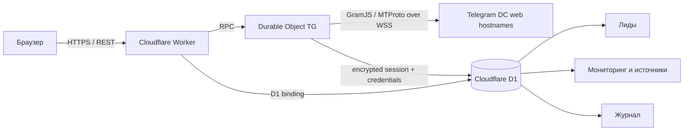
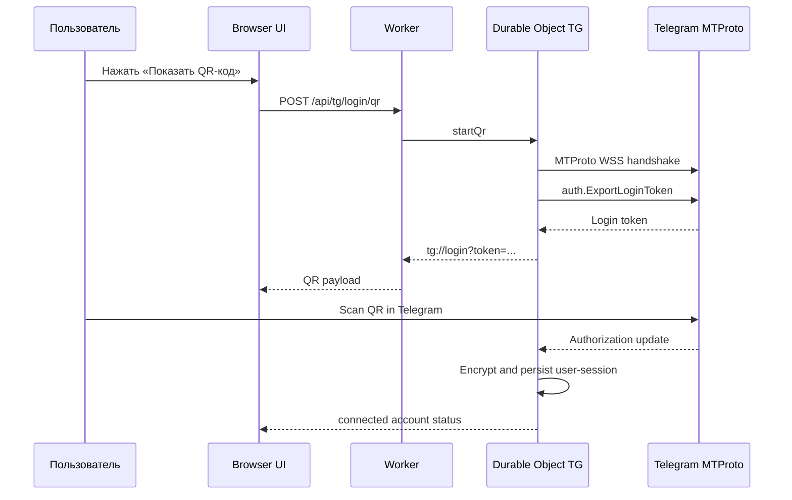

# Архитектура ZAMOVO

**Версия:** 1.5.0 · **Дата:** 24.11.2026

## 1. Текущая схема

## 2. Компоненты

| Компонент | Технология | Ответственность |
|---|---|---|
| Frontend | Static Assets, HTML/CSS/JS | Авторизация в панели, отображение аккаунта, QR, мониторинг и база |
| API | Cloudflare Worker | ADMIN_TOKEN, проверка запросов, бизнес-маршруты |
| Telegram session | Durable Object `TG` | Единственный активный user-account client и автомат состояний входа |
| Telegram adapter | GramJS | MTProto, QR/phone login, чтение доступных диалогов и сообщений |
| Database | Cloudflare D1 | Зашифрованные ключи приложения и user-session, лиды, источники, настройки, журналы |

В продукте нет Telegram-бота, Bot API webhook, токена бота, команды регистрации webhook или bot consent flow.

## 3. Разделение API-ключей и аккаунта

API ID и API Hash идентифицируют API-приложение. Они не определяют, какой Telegram-пользователь войдёт в систему. Одна пара ключей может использоваться для авторизации разных личных аккаунтов.

Хранилища разделены:
- `tg_app_credentials` — зашифрованные API ID и API Hash приложения.
- `tg_account` — зашифрованная MTProto user-session, статус и данные профиля текущего аккаунта.

Выход из аккаунта удаляет только user-session. API-ключи приложения сохраняются.

Миграция `0003_account_credentials_no_bot.sql` переносит существующие зашифрованные ключи из старых колонок `tg_account`, очищает их и удаляет устаревшие таблицы Bot API. Миграция `0004_dashboard_templates_phrases.sql` добавляет шаблоны фильтров, phrase-mode, дату исходного сообщения, run metrics и цель. Записи лидов и текущая сессия не удаляются.

## 4. Подключение Telegram в Cloudflare Workers

GramJS классифицирует Worker как Node runtime, так как в нём нет `window`. Стандартный выбор DC из GramJS поэтому может выдать IP-адрес, хотя приложение использует WebSocket over TLS.

В адаптере `src/tg/gramjs.js` переопределён `getDC`: все WSS-соединения используют доменные endpoint-ы Telegram:
- DC1 — `pluto.web.telegram.org`
- DC2 — `venus.web.telegram.org`
- DC3 — `aurora.web.telegram.org`
- DC4 — `vesta.web.telegram.org`
- DC5 — `flora.web.telegram.org`

Начальная сессия использует DC4; при восстановлении сохраняется DC ID, но серверный адрес нормализуется на WSS hostname. Этот resolver применяется и при переключении DC, и для download DC.

## 5. Поток входа

Вход по номеру телефона — отдельный flow с кодом и необязательным паролем 2FA.

## 6. Правила данных и источников

1. Telegram ID хранится строкой и уникален в таблице лидов.
2. Источники добавляются вручную из диалогов текущего авторизованного аккаунта.
3. Для канала сообщения комментариев читаются в связанной группе обсуждения.
4. Повторная обработка одного сообщения не создаёт повторное событие.
5. Первая проверка фиксирует baseline; дальше читаются только новые сообщения.
6. Ошибка одного источника не должна останавливать доступные источники.
7. Продукт не выполняет глобальный поиск пользователей, не обходит ограничения доступа и не отправляет нежелательные сообщения.

## 7. Миграции и конфигурация

Миграции D1 выполняются последовательно:
1. `0001_stage1_prototype.sql`
2. `0002_live_telegram_test.sql`
3. `0003_account_credentials_no_bot.sql`

Worker требует `ADMIN_TOKEN` и `APP_SECRET`. Для Telegram API keys можно использовать secrets `TELEGRAM_API_ID` и `TELEGRAM_API_HASH` либо сохранить ключи приложения на экране аккаунта. Секреты и user-session не передаются frontend.
